# Graphene-Based Terahertz Frequency Selective Rasorber (FSR) for 6G Communication

Design and simulation of an **Absorption–Transmission–Absorption (ATA) Frequency Selective Rasorber** for the **0.1–1 THz (sub-THz) band** using **CST Studio Suite 2019**. A gold **cross-slot FSS** provides a low-loss transmission window at ≈ 0.5 THz, and a **graphene-loaded absorption layer** (graphene conductivity modelled with the **Kubo formula**) absorbs the out-of-band signals on both sides of the passband. The effects of graphene chemical potential, relaxation time, scattering rate and temperature were studied first, then the FSS layer and the absorption layer were developed separately, integrated, optimised, and finally checked for **angular** and **polarization stability**.

*EC23702 – Mini Project, Department of ECE, College of Engineering Guindy, Anna University, Chennai.*

<p align="center">
  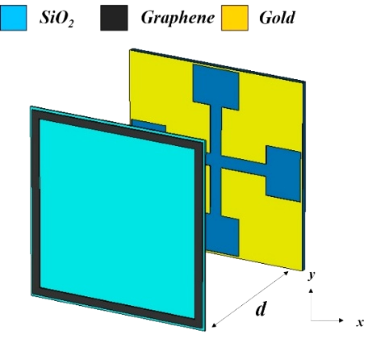
  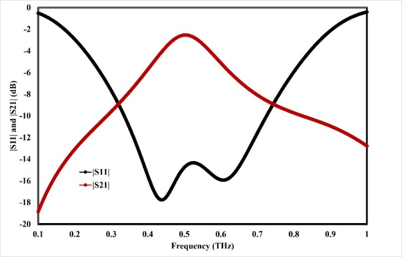<br>
  <em>Final optimised FSR (3D view) and its simulated S-parameters</em>
</p>

---

## Table of Contents

1. [Key Results](#1-key-results)
2. [Design Specifications](#2-design-specifications)
3. [Theoretical Background](#3-theoretical-background)
4. [Graphene Conductivity Study (Kubo Model)](#4-graphene-conductivity-study-kubo-model)
5. [FSS (Transmission) Layer](#5-fss-transmission-layer)
6. [Absorption Layer](#6-absorption-layer)
7. [Integrated FSR and Optimization](#7-integrated-fsr-and-optimization)
8. [Angular and Polarization Stability](#8-angular-and-polarization-stability)
9. [Comparison with Reported Designs](#9-comparison-with-reported-designs)
10. [Merits and Limitations](#10-merits-and-limitations)
11. [Repository Structure](#11-repository-structure)
12. [How to Reproduce](#12-how-to-reproduce)
13. [Notes on the Reported Values](#13-notes-on-the-reported-values)
14. [Future Work](#14-future-work)
15. [References](#15-references)
16. [Team and Acknowledgement](#16-team-and-acknowledgement)

---

## 1. Key Results

| Parameter | Value |
|---|---|
| FSR type | ATA (Absorption–Transmission–Absorption) |
| Passband centre frequency | ≈ 0.502 THz |
| Insertion loss of integrated FSR | ≈ 2.53 dB (S21 = −2.53 dB) after optimisation (−4.54 dB before) |
| −3 dB transmission bandwidth | 66.386 GHz |
| Lower absorption band (S11 < −10 dB) | 0.2809 – 0.4069 THz (FBW 36.64 %) |
| Upper absorption band (S11 < −10 dB) | 0.6184 – 0.7858 THz (FBW 23.84 %) |
| Peak absorptivity | ≈ 70 % in both bands (≈ 40 % in between) |
| FSS layer alone | f₀ = 0.503 THz, S21 = −0.46 dB, S11 = −24.41 dB, FBW 9.95 % |
| Absorption layer alone (μc = 0.45 eV) | S11 < −10 dB over 0.328 – 0.69 THz (FBW 71.1 %), −25 dB at 0.5 THz |
| Angular stability | f₀ = 0.49 – 0.50 THz and IL ≤ 3.0 dB up to θ = 30° (TE and TM) |
| Polarization stability | Identical response at φ = 0° and 90° (f₀ = 0.5 THz, IL = −2.5 dB) |
| Unit cell | 150 µm × 150 µm |
| Materials | Gold (Au), SiO₂, graphene |

---

## 2. Design Specifications

| Parameter | Specification |
|---|---|
| Operating band | 0.1 – 1 THz |
| FSR type | ATA (Absorption–Transmission–Absorption) |
| Conducting material | Gold (Au) |
| Resistive loading material | Graphene (Kubo conductivity model) |
| Substrate | Silicon dioxide (SiO₂) |
| Unit-cell periodicity | 150 µm × 150 µm |
| Graphene parameters (design) | thickness 1 nm, T = 300 K, τ = 1 ps, μc = 0.45 eV in the absorption layer |
| Simulation tool | CST Studio Suite 2019 |
| Target application | 6G communication, THz imaging/sensing, EMI suppression, RCS reduction |

**Objectives**

- Design a graphene-based ATA FSR for the 0.1–1 THz band for 6G communication.
- Model graphene with the Kubo formula and study μc, relaxation time, scattering rate and temperature.
- Develop a bandpass FSS layer with low insertion loss and a graphene-loaded wideband absorption layer.
- Integrate both layers and analyse transmission, reflection and absorption.
- Study angular and polarization stability and compare with reported designs.

---

## 3. Theoretical Background

### 3.1 Frequency Selective Rasorber

An FSR combines a lossless **FSS** with a lossy **absorbing layer** separated by a spacer. It transmits the desired band while absorbing out-of-band energy (low insertion loss in the passband, high absorption outside).

| Type | Behaviour |
|---|---|
| AT-FSR | Transmission at lower frequencies, absorption at higher frequencies |
| TA-FSR | Absorption at lower frequencies, transmission at higher frequencies |
| **ATA-FSR** (this work) | One transmission window between two absorption bands |


### 3.2 Kubo conductivity model of graphene

Total surface conductivity = intraband + interband contribution:

$$\sigma_g = \sigma_{intra} + \sigma_{inter}$$

$$\sigma_{intra} = \frac{-j e^{2} k_B T}{\pi\hbar^{2}(\omega - j2\Gamma)}\left[\frac{\mu_c}{k_B T} + 2\ln\!\left(e^{-\mu_c/k_B T}+1\right)\right]$$

$$\sigma_{inter} = \frac{-j e^{2}(\omega - j2\Gamma)}{\pi\hbar^{2}}\int_0^{\infty}\frac{f_d(-\varepsilon) - f_d(\varepsilon)}{(\omega - j2\Gamma)^2 - 4(\varepsilon/\hbar)^2}\,d\varepsilon$$

with scattering rate $\Gamma = 1/(2\tau)$.

| Symbol | Meaning |
|---|---|
| μc | Chemical potential (tunability) |
| ω | Angular frequency |
| T | Temperature |
| τ | Relaxation time |
| Γ = 1/2τ | Scattering rate |
| e = 1.602 × 10⁻¹⁹ C | Electron charge |
| ħ = 1.054 × 10⁻³⁴ J·s | Reduced Planck constant |
| k_B = 1.381 × 10⁻²³ J/K | Boltzmann constant |

- **Intraband** conductivity (motion within one band) dominates in the THz range.
- **Interband** conductivity (valence ↔ conduction transitions) matters at higher frequencies.

### 3.3 Performance metrics

Fractional bandwidth:

$$FBW = \frac{f_H - f_L}{f_C}\times 100\,\%$$

Absorptivity is evaluated from the simulated reflection coefficient (S11) of the absorbing structure.

---

## 4. Graphene Conductivity Study (Kubo Model)

Conductivity was computed over **0.1 – 1 THz** and the influence of each parameter was analysed.

### 4.1 Intraband vs interband (μc = 0.3 eV)

<p align="center">
  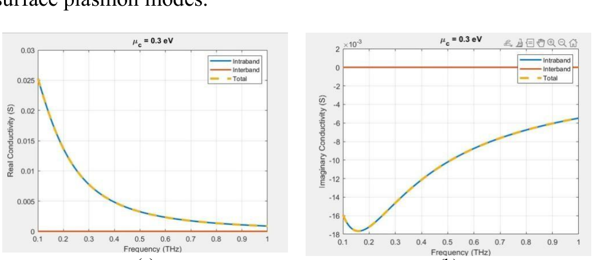<br>
  <em>Real and imaginary conductivity – total overlaps the intraband part; interband ≈ 0 (Pauli blocking)</em>
</p>

- Intraband conduction dominates in the THz range.
- Real conductivity decreases gradually with frequency; imaginary conductivity peaks near 0.15 THz, supporting surface plasmon modes.

### 4.2 Effect of chemical potential (0 – 1 eV)

<p align="center">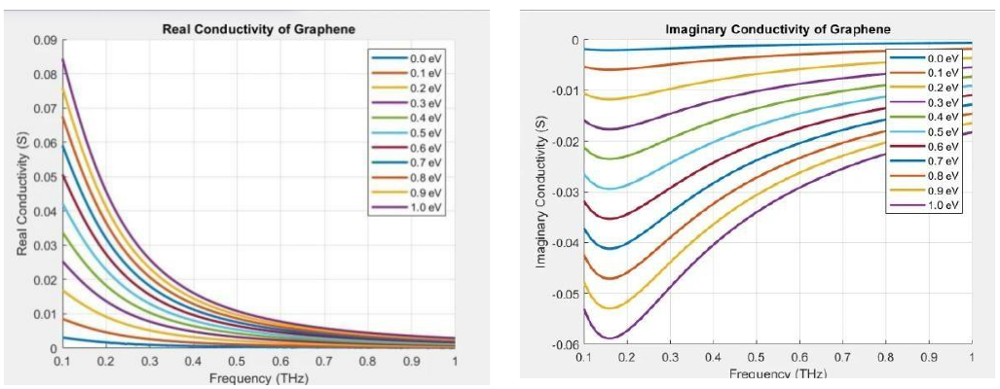</p>

- Higher μc → more free carriers → higher conductivity.
- Negative imaginary part (inductive) supports THz surface plasmon polaritons; voltage gating gives dynamic tuning.

### 4.3 Effect of relaxation time (0.1 – 5 ps)

<p align="center">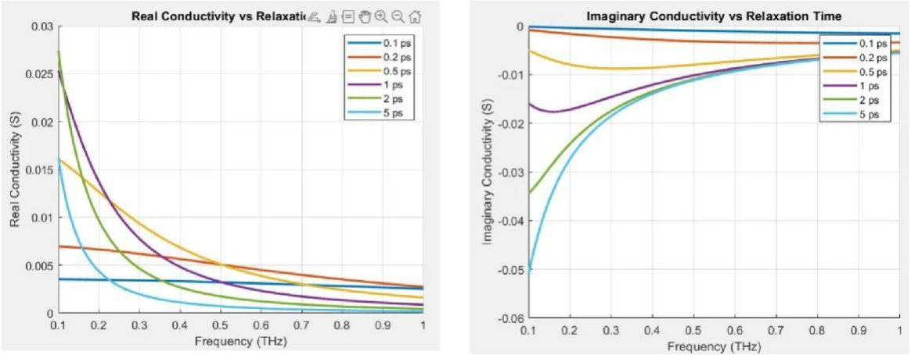</p>

- Longer τ → less scattering → higher low-frequency conductivity and stronger plasmon confinement.

### 4.4 Effect of scattering rate

<p align="center">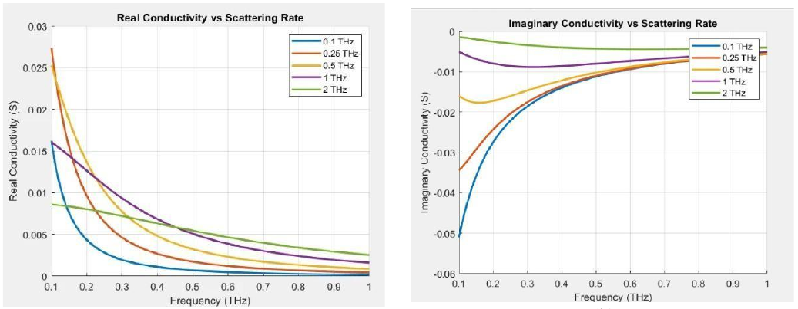</p>

- Low scattering rate (high mobility) gives higher real conductivity and a stronger inductive response – desirable for the FSR.

### 4.5 Effect of temperature (100 – 500 K)

<p align="center">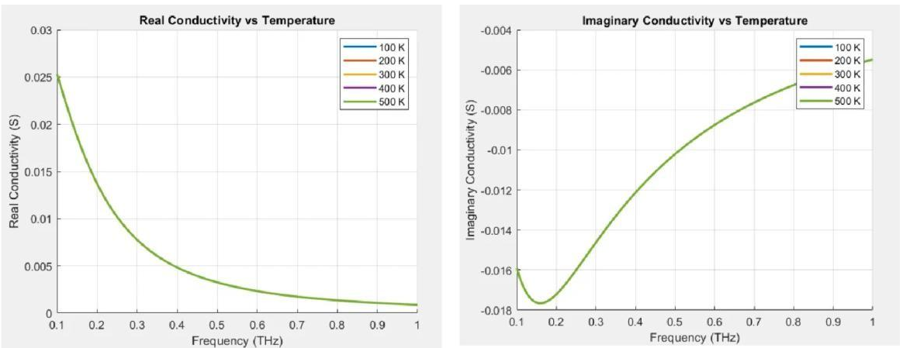</p>

- Curves overlap: conductivity is set by electrostatic gating, not thermal excitation, so the graphene loading is **thermally stable from 100 K to 500 K**.

---

## 5. FSS (Transmission) Layer

| Parameter | Value |
|---|---|
| Periodicity | 150 µm × 150 µm |
| Substrate | SiO₂, 8 µm (reduced to 4 µm in the final optimised FSR) |
| Conductor | Gold (Au) |
| Pattern | Cross slot with rectangular slot loading |

<p align="center">
  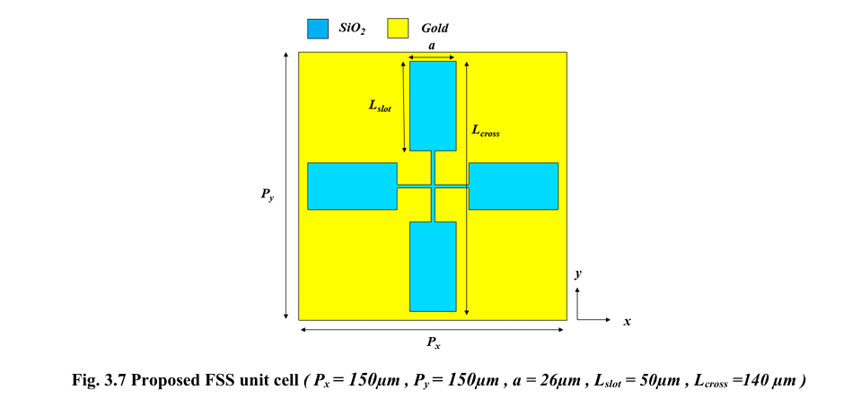<br>
  <em>Proposed FSS unit cell (Px = Py = 150 µm, a = 26 µm, Lslot = 50 µm, Lcross = 140 µm)</em>
</p>

### 5.1 Evolution of the FSS

| Stage | Structure | Resonance | Peak S21 | S11 | FBW |
|---|---|---|---|---|---|
| 1 | Cross slot (140 µm × 2 µm) | 0.715 THz | −2.5 dB | −12 dB | – |
| 2 | Jerusalem cross slot | 0.54 THz | ≈ −2.5 dB | ≈ −14 dB | – |
| 3 (final) | Cross slot + rectangular slot loading (50 µm × 26 µm) | **0.503 THz** | **−0.46 dB** | **−24.41 dB** | **9.95 %** |

<p align="center">
  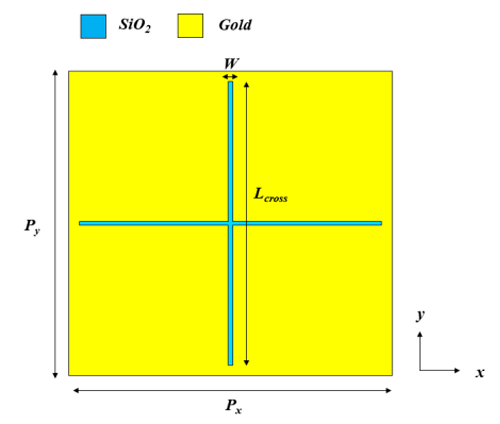
  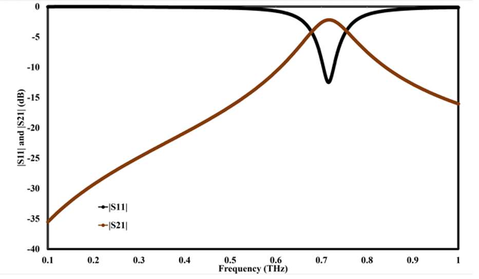<br>
  <em>Stage 1 – cross slot and its S-parameters</em>
</p>

<p align="center">
  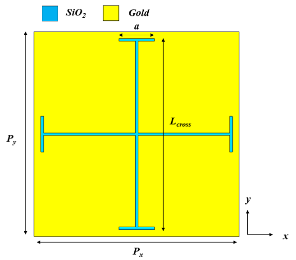
  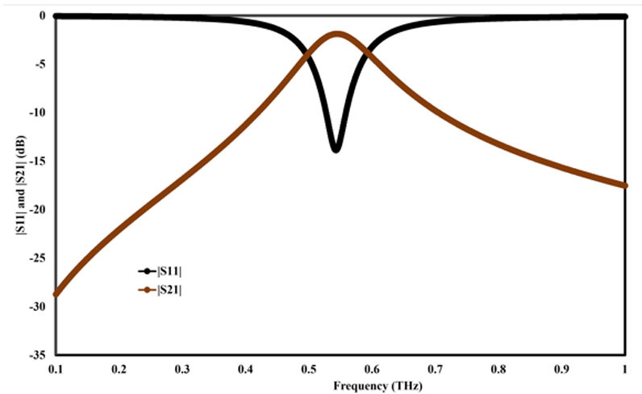<br>
  <em>Stage 2 – Jerusalem cross slot and its S-parameters</em>
</p>

<p align="center">
  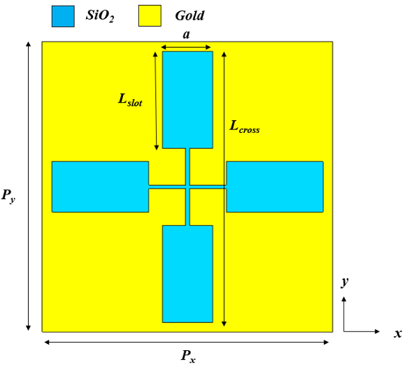
  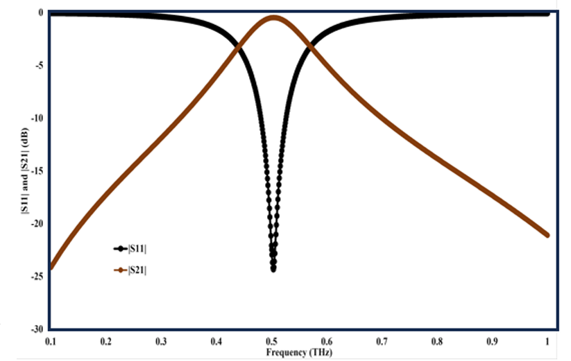<br>
  <em>Stage 3 – final FSS with rectangular slot loading and its S-parameters</em>
</p>

**Inference:** each geometrical step improves transmission and impedance matching; the final FSS gives a compact, low-loss passband at ≈ 0.5 THz, in the middle of the 0.1–1 THz band.

---

## 6. Absorption Layer

| Parameter | Value |
|---|---|
| Periodicity | 150 µm × 150 µm |
| Substrate | SiO₂, 1 µm |
| Conducting material | Gold (Au) |
| Lossy element | Graphene square ring / patches |
| Air gap | 150 µm |
| Dimensions | Linner = 120 µm, Louter = 146 µm, W = 13 µm, d = 150 µm |

<p align="center">
  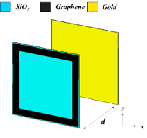
  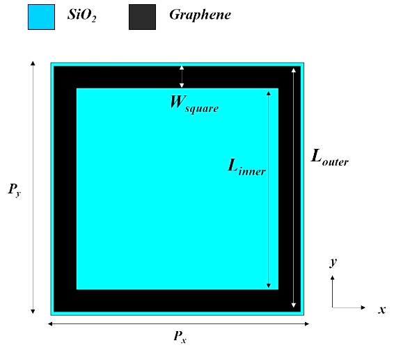<br>
  <em>Absorption layer – 3D view and unit cell</em>
</p>

**Chemical potential selection:** S11 was simulated for μc = 0–1 eV. **μc = 0.45 eV** gives the widest and deepest absorption; increasing μc further makes the graphene too conductive to act as a resistive load, so the bandwidth narrows and the absorption depth falls.

<p align="center">
  
  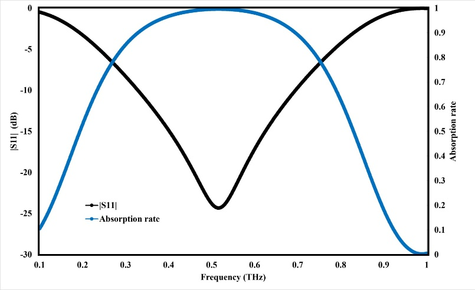<br>
  <em>Final absorption layer (μc = 0.45 eV) and its S11 / absorptivity</em>
</p>

- Absorption bandwidth **0.328 – 0.69 THz** with S11 < −10 dB (FBW 71.1 %).
- Strong resonance at 0.5 THz with S11 = −25 dB.

---

## 7. Integrated FSR and Optimization

### 7.1 Direct integration

The FSS layer and absorption layer were stacked to form the FSR. The passband stays near 0.5 THz, but the insertion loss rises to **≈ −4.54 dB** and the absorption response is distorted, due to resistive loading and **near-field coupling** between the gold cross-slot FSS and the absorption layer.

<p align="center">
  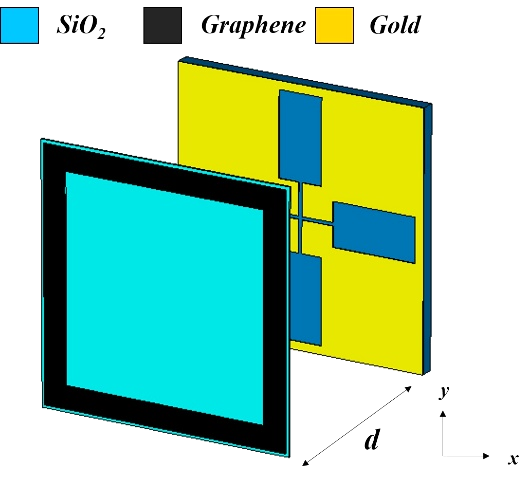
  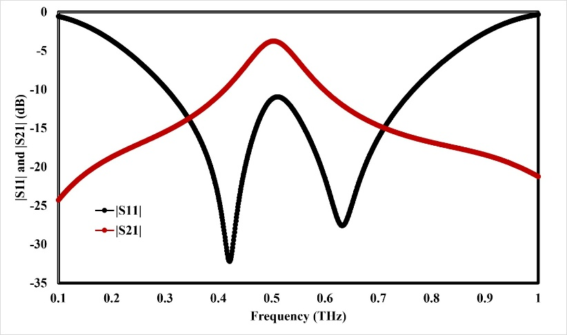<br>
  <em>Integrated FSR before optimisation – 3D view and S-parameters</em>
</p>

### 7.2 Structural optimization

| Layer | Parameter | Before | After |
|---|---|---|---|
| Absorption layer | Inner length `Linner` | 120 µm | 134 µm |
| Absorption layer | Square-ring width `W` | 13 µm | 6 µm |
| FSS layer | Cross length `Lcross` | 140 µm | 147 µm |
| FSS layer | Peripheral slot length `Lslot` | 50 µm | 30 µm |
| FSS layer | Cross slot width `W` | 2 µm | 10 µm |
| FSS layer | Substrate thickness | 8 µm | 4 µm |

<p align="center">
  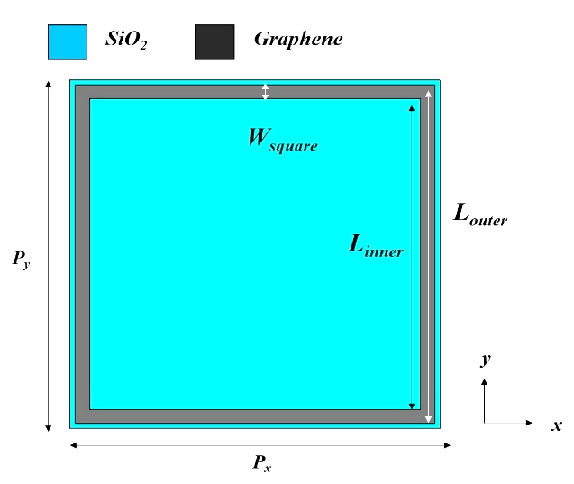
  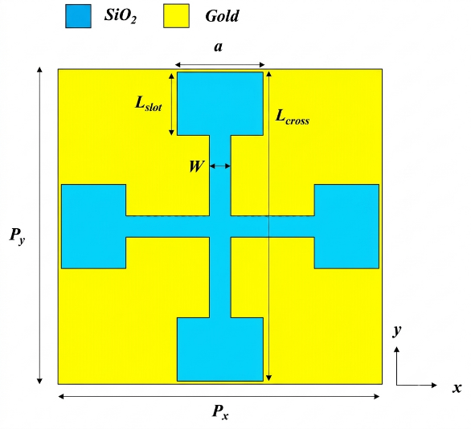<br>
  <em>Optimised absorption layer and optimised FSS layer</em>
</p>

### 7.3 Final FSR performance

<p align="center">
  
  <br>
  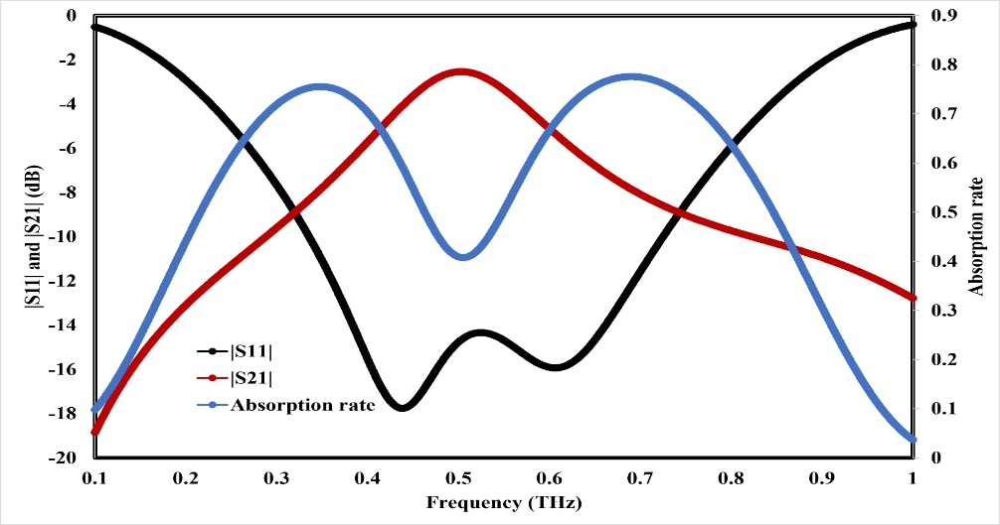<br>
  <em>Final FSR – 3D view, S-parameters, and S-parameters with absorptivity</em>
</p>

| Stage | Result |
|---|---|
| FSS layer | 0.503 THz, S21 ≈ −0.47 dB, S11 = −24.41 dB, FBW 9.95 % |
| Absorption layer (μc = 0.45 eV) | S11 < −10 dB over 0.328–0.69 THz, −25 dB at 0.5 THz, FBW 71.1 % |
| Integrated FSR – before optimisation | Passband at 0.5 THz, IL ≈ −4.54 dB, distorted absorption |
| **Integrated FSR – after optimisation** | **Passband at 0.502 THz, IL ≈ −2.53 dB, absorption 0.2809–0.4069 THz (36.64 %) and 0.6184–0.7858 THz (23.84 %), −3 dB bandwidth 66.38 GHz** |

Both absorption peaks reach ≈ 70 % absorptivity, with ≈ 40 % in the region between them.

---

## 8. Angular and Polarization Stability

### 8.1 Angular stability (θ = 0°, 15°, 30°, 40°, 45°, 60°; TE and TM)

<p align="center">
  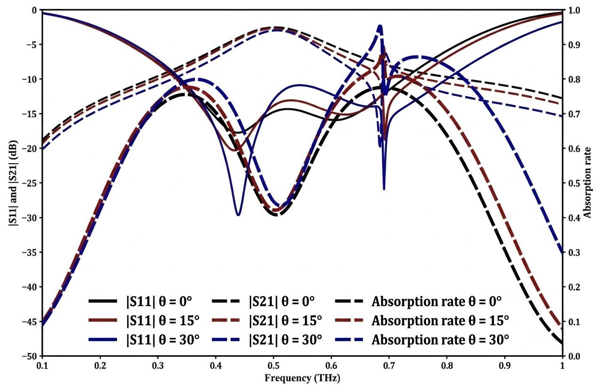
  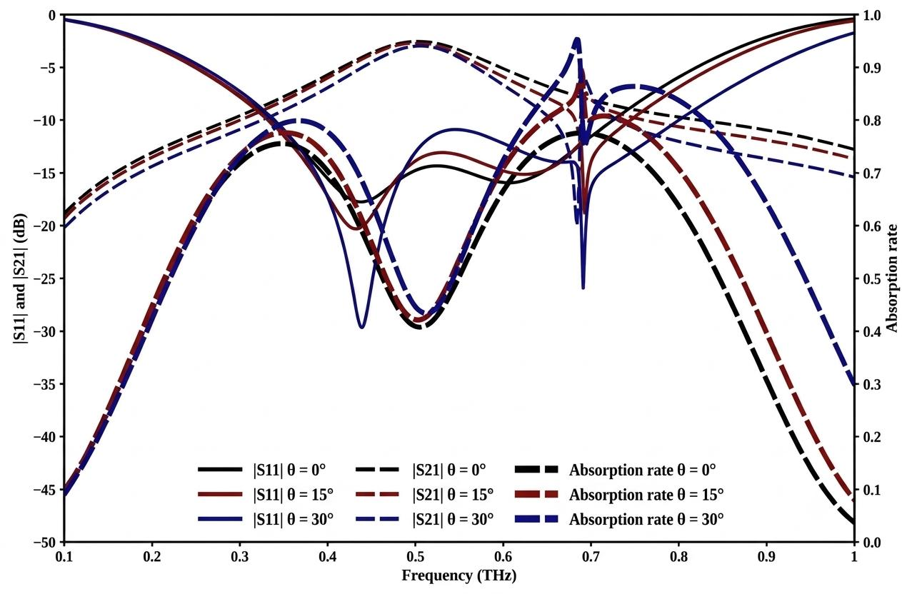<br>
  <em>S-parameters vs incidence angle – TE (left) and TM (right)</em>
</p>

| θ (°) | TE f₀ (THz) | TE IL (dB) | TM f₀ (THz) | TM IL (dB) | Absorption band (THz) |
|---|---|---|---|---|---|
| 0 | 0.50 | −2.53 | 0.49 | −2.60 | 0.33 – 0.72 |
| 15 | 0.49 | −2.70 | 0.49 | −2.74 | 0.33 – 0.74 |
| 30 | 0.50 | −2.96 | 0.50 | −3.00 | 0.33 – 0.80 |

- Passband centre stays at 0.49–0.50 THz (max. variation 10 GHz) for both polarizations up to 30°.
- Insertion-loss magnitude increases only by 0.43 dB (TE) and 0.40 dB (TM) from 0° to 30°.
- The absorption band widens with angle (0.39 THz at 0° → 0.47 THz at 30°); the lower edge stays at 0.33 THz.
- Good angular stability at low-to-moderate incidence (0°–30°); the small unit cell (150 µm) helps suppress grating effects.

### 8.2 Polarization stability (φ = 0° and 90°, normal incidence)

<p align="center">
  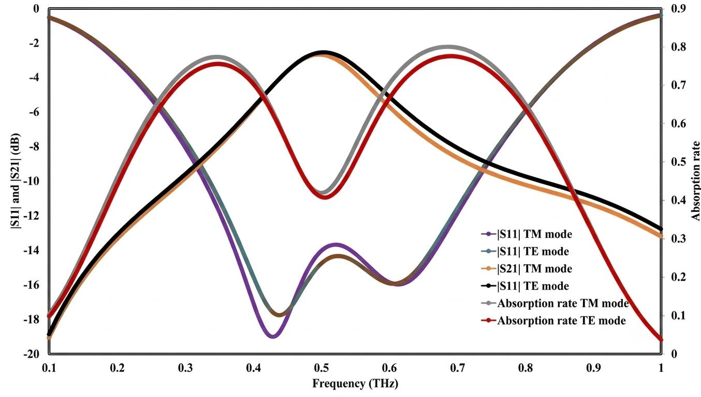<br>
  <em>S-parameters at φ = 0° and φ = 90°</em>
</p>

| φ (°) | f₀ (THz) | IL (dB) | Absorption band (THz) |
|---|---|---|---|
| 0 | 0.5 | −2.5 | 0.34 – 0.79 |
| 90 | 0.5 | −2.5 | 0.34 – 0.79 |

- The response is identical for both polarization angles – attributed to the four-fold symmetric unit cell.
- TM mode: peak absorption 80 % at 0.687 THz; TE mode: 77.6 % peak absorption.

---

## 9. Comparison with Reported Designs

| Reference | Passband (THz) | Insertion loss | Absorption band (THz) | Type | P (µm) | Substrate / spacer |
|---|---|---|---|---|---|---|
| Qu et al. (2020) | 0.63 | S21 > −3 dB | 0.25–0.55; 0.74–0.97 | ATA | 224 | SiO₂ / air (λ/4) |
| Qu and Li (2019) | 5.7–5.9 | S21 > −3 dB | 2.9–5.3; 6.45–8.65 | ATA | 27 | SiO₂ (1 µm) / air (λ/4) |
| Li et al. (2022) | 2.80 | 2.21 dB | 1.27–2.43 | A–T | 42 | Polyimide (6.8 µm) / Topas (13.5 µm) |
| Ghosh et al. (2022) | 13.56 | S21 > −3 dB | 2.24–4.67 | A–T | 12 | SiO₂ (14 µm) |
| Zhou et al. (2018) | 1.65 | \|S21\| > 0.7 | 0.5–1.0 | A–T | 80 | SiO₂ (55 µm) |
| Ali and Bhattacharya (2024) | 0.686 | 0.27 dB | 0.276–0.442; 0.861–1.094 | ATA | 80 | Polyamide / glass (55 µm) |
| **This work** | **0.503** | **2.5 dB** (FSS alone: 0.47 dB) | **0.2809–0.4069 (36.64 %); 0.6184–0.7858 (23.84 %)** | **ATA** | **150** | **SiO₂ (8 µm, 1 µm) / air (150 µm)** |

- Only two reported designs (Qu et al. 2020; Ali and Bhattacharya 2024) operate below 1 THz; this work is also sub-THz and ATA.
- Uses only gold, SiO₂ and graphene – no polymer spacer.
- Insertion loss (≈ 2.5 dB) is higher than Ali and Bhattacharya (0.27 dB) but comparable to Li et al. (2.21 dB). The isolated FSS reaches −0.47 dB, so lower loss is possible if inter-layer coupling is reduced.

---

## 10. Merits and Limitations

**Merits**

- Sub-THz operation for 6G – passband ≈ 0.5 THz with two absorption bands inside 0.1–1 THz.
- Low-loss FSS layer (−0.46 dB, S11 = −24.41 dB) in a compact 150 µm × 150 µm cell.
- Wideband graphene absorption layer (S11 < −10 dB over 0.328–0.69 THz).
- Simple material system (Au, SiO₂, graphene); thin graphene replaces bulky lumped resistors / resistive films.
- Thermally stable graphene loading (100–500 K).
- Four-fold symmetric cell → polarization-insensitive response.
- Systematic, stage-by-stage design flow.

**Limitation:** the insertion loss of the integrated structure (≈ 2.5 dB) is higher than the isolated FSS; addressed in [Future Work](#14-future-work).

---

## 11. Repository Structure

```
.
├── README.md
├── images/                  # all figures used in this README
├── docs/
│   ├── EC23702_Mini_Project_Review.pptx   # review presentation
│   └── Mini_Project_Report.pdf            # full project report
├── simulation/              # (add) CST Studio Suite 2019 project files (.cst)
├── matlab/                  # (add) Kubo conductivity scripts, if available
└── LICENSE                  # (add)
```

---

## 12. How to Reproduce

1. Open **CST Studio Suite 2019** and create a new project with a **unit-cell** boundary setup (periodic in x and y, Floquet ports in z) for the 0.1–1 THz range.
2. Define the unit cell with `Px = Py = 150 µm`.
3. **FSS layer:** gold sheet on SiO₂ (8 µm, later 4 µm) with the cross slot (`Lcross`, `W`) and four rectangular loading slots (`Lslot`, `a = 26 µm`).
4. **Absorption layer:** SiO₂ (1 µm) carrying the graphene square ring (`Linner`, `Louter`, `W`), placed at a 150 µm air gap.
5. Model graphene as a surface-impedance material from the **Kubo conductivity** (τ = 1 ps, T = 300 K, μc = 0.45 eV, thickness 1 nm).
6. Simulate each layer separately, then stack them into the FSR and apply the optimised dimensions of [Section 7.2](#72-structural-optimization).
7. Extract S11, S21 and absorptivity; repeat with θ = 0°–60° (TE/TM) and φ = 0°/90° for the stability study.

---

## 13. Notes on the Reported Values

- **Insertion loss sign:** values such as −2.53 dB are S21 in dB; the corresponding insertion loss is 2.53 dB.
- **Passband frequency:** quoted as 0.5 THz in tables and 0.502 THz in the text for the optimised FSR.
- **Absorption-band definitions:** 0.2809–0.4069 / 0.6184–0.7858 THz are the S11 < −10 dB bands of the optimised FSR; 0.33–0.72 THz (angular table) and 0.34–0.79 THz (polarization table) are bands read from the plots.
- **Graphene chemical potential:** the absorption layer and FSR use **μc = 0.45 eV**.
- **FSS substrate thickness:** 8 µm during FSS design and integration; reduced to 4 µm in the final optimisation.

---

## 14. Future Work

- Optimise spacing, unit-cell geometry and graphene loading to reduce passband insertion loss while restoring wideband absorption.
- Extend the angular and polarization analysis to the optimised structure and evaluate absorptivity over the full 0.1–1 THz band.
- Investigate fabrication (graphene transfer onto SiO₂, layer alignment with the air gap) and verify by measurement.
- Assess the optimised FSR as a radome for 6G communication.

---

## 15. References

1. M. Qu, T. Chang, G. Guo, and S. Li, "Design of Graphene-Based Dual-Polarized Switchable Rasorber/Absorber at Terahertz," *IEEE Access*, vol. 8, pp. 127220–127225, 2020, doi: 10.1109/ACCESS.2020.3008417.
2. M. Qu and S. Li, "Graphene-based polarization insensitive rasorber with tunable passband," *Results in Physics*, vol. 14, Art. no. 102172, Sep. 2019, doi: 10.1016/j.rinp.2019.102172.
3. M. Li, C. Huang, C. Huang, Y. Song, H. Shao, and J. Dong, "Graphene integrated rasorber at terahertz frequencies with functionalities of both absorption and transmission," *Results in Physics*, vol. 41, Art. no. 105959, Sep. 2022, doi: 10.1016/j.rinp.2022.105959.
4. S. K. Ghosh, S. Das, and S. Bhattacharyya, "Graphene-Based Metasurface for Tunable Absorption and Transmission Characteristics in the Near Mid-Infrared Region," *IEEE Trans. Antennas Propag.*, vol. 70, no. 6, pp. 4600–4609, Jun. 2022, doi: 10.1109/TAP.2022.3143058.
5. Q. Zhou et al., "Graphene Based Controllable Broadband Terahertz Metamaterial Absorber with Transmission Band," *Materials*, vol. 11, no. 12, Art. no. 2514, Dec. 2018, doi: 10.3390/ma11122514.
6. M. F. Ali and R. Bhattacharya, "Polarization-insensitive graphene-based THz rasorber with ATA characteristics," *Phys. Scr.*, vol. 99, no. 1, Art. no. 015501, 2024, doi: 10.1088/1402-4896/ad0fcc.
7. D. Zhang et al., "A terahertz graphene-metamaterial sensor for highly sensitive detection of trace pesticide metaldehyde," *PLoS ONE*, vol. 20, no. 12, p. e0338331, Dec. 2025, doi: 10.1371/journal.pone.0338331.

---

## 16. Team and Acknowledgement

**Team**

- Nivetha N
- Shanmugavalli P
- Mirunalini S
- Divya Darshni M

**Supervisor:** Dr. M. Gulam Nabi Alsath, Associate Professor, Department of ECE, College of Engineering Guindy, Anna University, Chennai.
**Head of the Department:** Dr. M. A. Bhagyaveni, Professor, Department of ECE.

Thanks to Ms. Geethanjali and Mr. Harienthiran for their help and support during the project.
